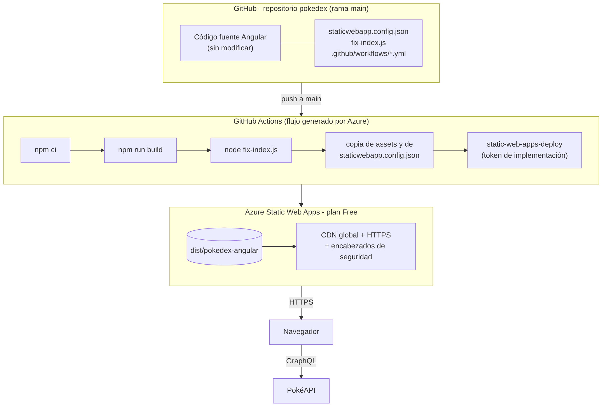
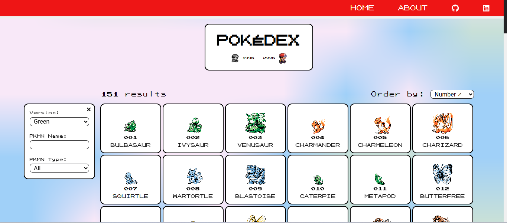
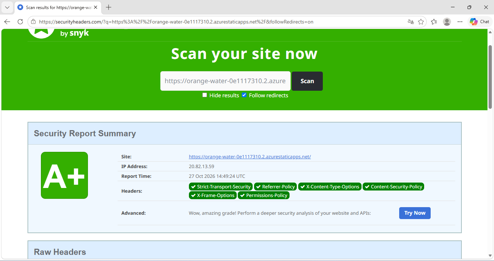

# Despliegue de PokeDex en Azure Static Web Apps

Este documento describe cómo se publicó la aplicación PokeDex (Angular 14) en Microsoft Azure usando el servicio Static Web Apps con la suscripción Azure for Students, y cómo se configuraron los encabezados HTTP de seguridad para obtener la calificación A+ en securityheaders.com.

- URL pública: https://orange-water-0e1117310.2.azurestaticapps.net
- Repositorio: https://github.com/jarlin19/pokedex
- Creación de la cuenta de Azure y del recurso: ver [README.md](./README.md)

El código fuente de la aplicación no se modificó. Todo el despliegue se resolvió con la compilación estándar del proyecto (`npm run build`), un archivo de configuración del servicio (`staticwebapp.config.json`) y el flujo de GitHub Actions que publica la aplicación.

## Contenido

1. [Arquitectura](#1-arquitectura)
2. [Requisitos previos](#2-requisitos-previos)
3. [Preparar el repositorio](#3-preparar-el-repositorio)
4. [Crear la Static Web App](#4-crear-la-static-web-app)
5. [Flujo de GitHub Actions](#5-flujo-de-github-actions)
6. [Configuración del servicio: staticwebapp.config.json](#6-configuración-del-servicio-staticwebappconfigjson)
7. [Publicar](#7-publicar)
8. [Verificar el despliegue](#8-verificar-el-despliegue)
9. [Encabezados de seguridad](#9-encabezados-de-seguridad)
10. [Escaneo en securityheaders.com](#10-escaneo-en-securityheaderscom)
11. [Actualizar la aplicación](#11-actualizar-la-aplicación)
12. [Problemas encontrados y solución](#12-problemas-encontrados-y-solución)
13. [Despliegue anterior en App Service](#13-despliegue-anterior-en-app-service)
14. [Resumen de comandos](#14-resumen-de-comandos)
15. [Referencias](#15-referencias)

## 1. Arquitectura



| Componente | Descripción |
|---|---|
| PokeDex (Angular 14) | Aplicación de una sola página (SPA) que consume PokéAPI. Se publica como archivos estáticos generados por `ng build`. |
| GitHub | Repositorio `jarlin19/pokedex` con el código fuente original, los archivos de configuración y la documentación. |
| GitHub Actions | En cada push a la rama `main` compila la aplicación y la envía a Azure. El flujo lo crea Azure al vincular el repositorio y se ajustó para este proyecto. |
| Azure Static Web Apps (plan Free) | Servicio de Azure para sitios estáticos. Sirve los archivos por HTTPS desde una red de distribución global, resuelve las rutas de la SPA y agrega los encabezados de seguridad definidos en `staticwebapp.config.json`. No consume el crédito de la suscripción. |

## 2. Requisitos previos

| Herramienta | Versión usada | Uso |
|---|---|---|
| Cuenta Azure for Students | - | Crear la Static Web App |
| Cuenta de GitHub | - | Repositorio `pokedex` y GitHub Actions |
| Git | 2.x | Clonar y versionar |
| Node.js | 24.x en el equipo local (sirve 18 o superior); 20 en GitHub Actions | `npm install` y `npm run build` |
| StackEdit | web | Redacción de la documentación en Markdown |

## 3. Preparar el repositorio

### 3.1 Obtener el código fuente

El código fuente lo entrega la compañía en el repositorio del curso. Se clona y se copia la carpeta de la aplicación a la carpeta del repositorio propio `pokedex`:

```bat
cd /d C:\Users\sistemas\Documents
git clone https://github.com/rcuello/ac4dem1a.git
mkdir pokedex
xcopy /E /H /Y ac4dem1a\sistemas-distribuidos\poke-dex-lab\source\pokedex-angular pokedex\
cd pokedex
ren README.md README-pokedex-angular.md
rmdir /S /Q .github
```

- `ren README.md ...` conserva el README original del proyecto con otro nombre, porque el `README.md` de este repositorio debe ser el tutorial de creación de la cuenta.
- `rmdir .github` elimina el flujo de GitHub Actions del autor original (publicaba cobertura de pruebas en Codecov con un token privado y fallaría en este repositorio). No hace parte de la aplicación. Más adelante Azure crea en esa misma carpeta el flujo de despliegue.

Ningún archivo de `src/`, `angular.json`, `package.json`, `package-lock.json`, `tsconfig*.json` ni `webpack.config.ts` fue modificado.

### 3.2 Archivos agregados

| Archivo | Para qué sirve |
|---|---|
| `staticwebapp.config.json` | Configuración de la Static Web App: encabezados de seguridad y regla de rutas de la SPA. El flujo lo copia junto a los archivos compilados. Ver la sección 6. |
| `fix-index.js` | Script de Node que ajusta el `index.html` generado por la compilación (no el de `src/`) para que funcione con la política de seguridad de contenido (CSP) estricta. Ver la sección 9.3. |
| `.github/workflows/azure-static-web-apps-orange-water-0e1117310.yml` | Flujo de GitHub Actions que compila y publica la aplicación. Lo crea Azure al vincular el repositorio y se ajustó como se explica en la sección 5. |
| `README.md` | Tutorial de creación de la cuenta en Azure y del recurso. |
| `Despliegue.md` | Este documento. |

Estructura final del repositorio:

```
pokedex/
├── .github/workflows/azure-static-web-apps-orange-water-0e1117310.yml   (flujo de despliegue)
├── .browserslistrc, .czrc, .editorconfig, .eslintrc.json, .gitignore, .husky/, .lintstagedrc, .prettierrc, .vscode/
├── angular.json
├── karma.conf.js
├── package.json
├── package-lock.json
├── tsconfig.json / tsconfig.app.json / tsconfig.spec.json
├── webpack.config.ts
├── src/                        (aplicación Angular, sin cambios)
├── docs/img/                   (capturas de pantalla de esta documentación)
├── staticwebapp.config.json    (nuevo)
├── fix-index.js                (nuevo)
├── README.md                   (nuevo)
├── README-pokedex-angular.md   (README original del proyecto)
└── Despliegue.md               (nuevo)
```

### 3.3 Subir al repositorio

El repositorio se creó vacío en GitHub (sin README ni .gitignore) y se subió el contenido desde el equipo. Los commits quedan a nombre del autor configurado en el repositorio local:

```bat
git init
git config user.name "Jarlin Morelos"
git config user.email "jarlinmorelos201@gmail.com"
git remote add origin https://jarlin19@github.com/jarlin19/pokedex.git
git add .
git commit -m "PokeDex: codigo fuente original + configuracion para Azure Static Web Apps"
git branch -M main
git push -u origin main
```

El usuario en la URL del remoto (`jarlin19@github.com`) hace que Git pida las credenciales de esa cuenta en lugar de usar otras que pudiera tener guardadas el equipo. El `.gitignore` del proyecto excluye `node_modules/` y `dist/`, así que al repositorio solo sube el código fuente, los archivos de configuración y la documentación.

El repositorio se creó con el nombre `pokedex1` y después se renombró a `pokedex` en GitHub (Settings > General > Repository name). GitHub redirige el nombre anterior, así que la Static Web App ya vinculada siguió funcionando; en el equipo local solo se actualizó el remoto:

```bat
git remote set-url origin https://jarlin19@github.com/jarlin19/pokedex.git
```

## 4. Crear la Static Web App

En el portal de Azure (https://portal.azure.com): buscar "Static Web Apps" > Crear.

| Campo | Valor |
|---|---|
| Suscripción | Azure for Students |
| Grupo de recursos | Crear nuevo: `rg-pokedex` |
| Nombre | `pokedex-morelos` |
| Tipo de plan | Free |
| Región | Central US |
| Origen de implementación | GitHub |
| Organización / Repositorio / Rama | `jarlin19` / `pokedex` / `main` |
| Valores preestablecidos de compilación | Angular |
| Ubicación de la aplicación | `/` |
| Ubicación de la API | vacío |
| Ubicación de salida | `dist` |
| Directiva de autorización de implementación | Token de implementación |


Al pulsar Crear, Azure:

1. Crea el recurso y le asigna la URL `https://orange-water-0e1117310.2.azurestaticapps.net`.
2. Guarda en el repositorio el secreto `AZURE_STATIC_WEB_APPS_API_TOKEN_ORANGE_WATER_0E1117310` (Settings > Secrets and variables > Actions) con el token de implementación.
3. Hace un commit en `main` con el archivo `.github/workflows/azure-static-web-apps-orange-water-0e1117310.yml` y lanza la primera ejecución del flujo.

Esa primera ejecución falló, porque el flujo generado compila con las herramientas de Azure y busca `index.html` directamente en `dist`, mientras que Angular lo genera en `dist/pokedex-angular` (sección 12). Por eso el flujo se reemplazó por el de la sección siguiente.

## 5. Flujo de GitHub Actions

Después del primer intento se hizo `git pull` para traer el archivo que creó Azure y se reemplazó su contenido por este (también se puede editar directamente en GitHub con el botón del lápiz):

```yaml
name: Azure Static Web Apps CI/CD

on:
  push:
    branches:
      - main
  pull_request:
    types: [opened, synchronize, reopened, closed]
    branches:
      - main

jobs:
  build_and_deploy_job:
    if: github.event_name == 'push' || (github.event_name == 'pull_request' && github.event.action != 'closed')
    runs-on: ubuntu-latest
    name: Build and Deploy Job
    env:
      HUSKY: 0
    steps:
      - uses: actions/checkout@v4
        with:
          submodules: true
          lfs: false

      - name: Configurar Node.js
        uses: actions/setup-node@v4
        with:
          node-version: 20
          cache: npm

      - name: Instalar dependencias
        run: npm ci

      - name: Compilar Angular
        run: npm run build

      - name: Ajustar index.html generado
        run: node fix-index.js

      - name: Copia de assets en la ruta heredada /pokedex-angular/assets
        run: mkdir -p dist/pokedex-angular/pokedex-angular && cp -r dist/pokedex-angular/assets dist/pokedex-angular/pokedex-angular/

      - name: Copiar staticwebapp.config.json
        run: cp staticwebapp.config.json dist/pokedex-angular/

      - name: Build And Deploy
        id: builddeploy
        uses: Azure/static-web-apps-deploy@v1
        with:
          azure_static_web_apps_api_token: ${{ secrets.AZURE_STATIC_WEB_APPS_API_TOKEN_ORANGE_WATER_0E1117310 }}
          repo_token: ${{ secrets.GITHUB_TOKEN }}
          action: "upload"
          app_location: "dist/pokedex-angular"
          api_location: ""
          output_location: ""
          skip_app_build: true
          skip_api_build: true

  close_pull_request_job:
    if: github.event_name == 'pull_request' && github.event.action == 'closed'
    runs-on: ubuntu-latest
    name: Close Pull Request Job
    steps:
      - name: Close Pull Request
        id: closepullrequest
        uses: Azure/static-web-apps-deploy@v1
        with:
          azure_static_web_apps_api_token: ${{ secrets.AZURE_STATIC_WEB_APPS_API_TOKEN_ORANGE_WATER_0E1117310 }}
          action: "close"
```

Qué hace cada paso:

| Paso | Qué hace |
|---|---|
| `env: HUSKY: 0` | Desactiva los hooks de Husky que trae el proyecto (solo sirven para el equipo del desarrollador, no en un servidor de integración). |
| `actions/checkout` | Descarga el código del repositorio en la máquina de GitHub Actions. |
| `actions/setup-node` (Node 20) | Instala Node.js 20 LTS y guarda en caché las dependencias de npm para acelerar las siguientes ejecuciones. |
| `npm ci` | Instala las dependencias exactas del `package-lock.json` del proyecto. |
| `npm run build` | Ejecuta el script `build` del proyecto (`ng build` en modo producción) y genera la carpeta `dist/pokedex-angular`. |
| `node fix-index.js` | Ajusta el `index.html` generado para la CSP estricta (sección 9.3). |
| Copia de assets | El archivo `environment.prod.ts` del proyecto original apunta las imágenes a `/pokedex-angular/assets/images` (la ruta que tenía en GitHub Pages). Static Web Apps no reescribe rutas con comodines, así que se copia la carpeta `assets` también en esa ruta dentro de `dist` y los sprites cargan sin modificar el código. |
| Copiar `staticwebapp.config.json` | El archivo de configuración debe estar en la raíz de la carpeta que se publica. |
| `Azure/static-web-apps-deploy` | Sube el contenido de `dist/pokedex-angular` a la Static Web App usando el token de implementación. `skip_app_build: true` indica que la carpeta ya está compilada, así Azure no vuelve a compilar y publica los archivos tal cual. |
| `close_pull_request_job` | Lo trae el flujo de Azure por defecto: elimina el entorno de vista previa cuando se cierra una pull request. |

Salida de los pasos principales en GitHub Actions:

```
Compilar Angular
  Initial Chunk Files           | Names         |  Raw Size | Estimated Transfer Size
  main.2f4efbb8fe88ed5e.js      | main          | 561.00 kB |              147.60 kB
  polyfills.fa6f98b6deae32c5.js | polyfills     |  33.09 kB |               10.65 kB
  styles.c5cc939de274df97.css   | styles        |   5.30 kB |                1.37 kB
  runtime.66362e1586845856.js   | runtime       |   2.86 kB |                1.39 kB
  Warning: ... pokemon-details.component.scss exceeded maximum budget ...
  Warning: bundle initial exceeded maximum budget ...

Ajustar index.html generado
  [fix-index] index.html ajustado para CSP estricta: dist/pokedex-angular/index.html

Build And Deploy
  App Directory Location: 'dist/pokedex-angular' was found.
  Skipping step to build dist/pokedex-angular with Oryx
  Zipping App Artifacts
  Uploading build artifacts.
  Status: Succeeded. Time: ...
  Deployment Complete :)
  Visit your site at: https://orange-water-0e1117310.2.azurestaticapps.net
```

Las dos advertencias de tamaño son propias del proyecto original y no impiden la compilación.

## 6. Configuración del servicio: staticwebapp.config.json

Static Web Apps lee este archivo desde la raíz de la carpeta publicada. Tiene dos partes: la regla de rutas de la SPA y los encabezados que se agregan a todas las respuestas.

```json
{
  "navigationFallback": {
    "rewrite": "/index.html",
    "exclude": [ "/assets/*", "/pokedex-angular/*", "/*.{js,css,ttf,png,jpg,gif,ico,txt,map}" ]
  },
  "globalHeaders": {
    "Content-Security-Policy": "default-src 'self'; script-src 'self'; style-src 'self' 'unsafe-inline' https://fonts.googleapis.com; font-src 'self' https://fonts.gstatic.com; img-src 'self' data: https://assets.pokemon.com; connect-src 'self' https://pokeapi.co https://beta.pokeapi.co; object-src 'none'; base-uri 'self'; form-action 'self'; frame-ancestors 'none'; upgrade-insecure-requests",
    "Strict-Transport-Security": "max-age=31536000; includeSubDomains; preload",
    "X-Frame-Options": "DENY",
    "X-Content-Type-Options": "nosniff",
    "Referrer-Policy": "strict-origin-when-cross-origin",
    "Permissions-Policy": "accelerometer=(), camera=(), geolocation=(), gyroscope=(), magnetometer=(), microphone=(), payment=(), usb=()",
    "Cross-Origin-Opener-Policy": "same-origin",
    "Cross-Origin-Resource-Policy": "same-origin",
    "X-Permitted-Cross-Domain-Policies": "none"
  }
}
```

| Sección | Qué hace |
|---|---|
| `navigationFallback.rewrite` | Cualquier URL que no corresponda a un archivo existente devuelve `index.html`, para que el enrutador de Angular muestre la vista (`/pokemon/25`, `/about`, recarga con F5). |
| `navigationFallback.exclude` | Las rutas de archivos estáticos (`/assets/*`, la copia en `/pokedex-angular/*` y los archivos `.js`, `.css`, `.png`, etc.) no entran en la regla anterior: si no existen responden 404 en lugar de devolver `index.html`. |
| `globalHeaders` | Encabezados de seguridad que el servicio agrega a todas las respuestas (sección 9). |

## 7. Publicar

Con el flujo y el archivo de configuración en el repositorio, publicar es hacer push a `main`:

```bat
git add .
git commit -m "Flujo de despliegue y configuracion de Static Web Apps"
git push
```

En GitHub, pestaña Actions, aparece la ejecución "Azure Static Web Apps CI/CD". Tarda unos minutos (instalación de dependencias, compilación y carga). Cuando termina con el indicador en verde, la aplicación ya está publicada en la URL de la Static Web App. En el portal de Azure, en la Información general del recurso, también se ve el estado del último despliegue.

## 8. Verificar el despliegue

1. Abrir https://orange-water-0e1117310.2.azurestaticapps.net. Debe cargar la Pokédex con 151 resultados y los sprites de la versión Green.
2. Cambiar la versión (Red & Blue, Yellow, Gold...), filtrar por nombre y tipo, y ordenar.
3. Abrir el detalle de un Pokémon (por ejemplo `/pokemon/25`) y recargar la página con F5: debe seguir funcionando gracias a la regla `navigationFallback`.
4. Abrir las herramientas de desarrollador del navegador (F12 > Consola): no debe haber errores ni mensajes "Refused to ..." de la CSP.
5. Comprobar los encabezados desde la consola:

```bat
curl -I https://orange-water-0e1117310.2.azurestaticapps.net
```

Respuesta (fragmento):

```
HTTP/1.1 200 OK
Content-Type: text/html
Content-Security-Policy: default-src 'self'; script-src 'self'; style-src 'self' 'unsafe-inline' https://fonts.googleapis.com; ...
Strict-Transport-Security: max-age=31536000; includeSubDomains; preload
X-Frame-Options: DENY
X-Content-Type-Options: nosniff
Referrer-Policy: strict-origin-when-cross-origin
Permissions-Policy: accelerometer=(), camera=(), geolocation=(), ...
Cross-Origin-Opener-Policy: same-origin
Cross-Origin-Resource-Policy: same-origin
X-Permitted-Cross-Domain-Policies: none
```



## 9. Encabezados de seguridad

### 9.1 Encabezados configurados en `staticwebapp.config.json`

| Encabezado | Valor | Qué protege |
|---|---|---|
| `Content-Security-Policy` | `default-src 'self'; script-src 'self'; style-src 'self' 'unsafe-inline' https://fonts.googleapis.com; font-src 'self' https://fonts.gstatic.com; img-src 'self' data: https://assets.pokemon.com; connect-src 'self' https://pokeapi.co https://beta.pokeapi.co; object-src 'none'; base-uri 'self'; form-action 'self'; frame-ancestors 'none'; upgrade-insecure-requests` | Solo permite scripts propios (mitiga XSS), limita de dónde se cargan estilos, fuentes e imágenes y a qué API se conecta la aplicación; prohíbe plugins, cambios de `<base>` e inserción en iframes. |
| `Strict-Transport-Security` | `max-age=31536000; includeSubDomains; preload` | Obliga HTTPS durante un año (HSTS). |
| `X-Frame-Options` | `DENY` | Evita clickjacking. |
| `X-Content-Type-Options` | `nosniff` | Impide que el navegador adivine tipos MIME. |
| `Referrer-Policy` | `strict-origin-when-cross-origin` | No envía la URL completa a otros sitios. |
| `Permissions-Policy` | `accelerometer=(), camera=(), geolocation=(), gyroscope=(), magnetometer=(), microphone=(), payment=(), usb=()` | Deshabilita APIs del navegador que la aplicación no usa. |
| `Cross-Origin-Opener-Policy` | `same-origin` | Aísla la ventana de otros orígenes. |
| `Cross-Origin-Resource-Policy` | `same-origin` | Impide que otros sitios carguen los recursos de la aplicación. |
| `X-Permitted-Cross-Domain-Policies` | `none` | Bloquea políticas cross-domain de Flash y Acrobat. |

Static Web Apps ya responde solo por HTTPS (redirige HTTP a HTTPS) y no expone encabezados con la versión del servidor, por lo que no hubo que configurar nada adicional en el portal.

### 9.2 Cómo se definió la CSP

La política se construyó a partir de los orígenes que la aplicación usa realmente, revisando el código fuente:

| Directiva | Origen permitido | Dónde se usa en el proyecto |
|---|---|---|
| `script-src 'self'` | Solo el propio sitio | Angular compila en modo AOT; no necesita `unsafe-eval` ni scripts externos. |
| `style-src 'unsafe-inline'` | Estilos inline | Angular 14 inyecta los estilos de cada componente en etiquetas `<style>` en tiempo de ejecución (el soporte de nonce llegó en Angular 16). Es el mínimo que documenta Angular y securityheaders.com no penaliza `unsafe-inline` en `style-src`, solo en `script-src`. |
| `style-src https://fonts.googleapis.com` y `font-src https://fonts.gstatic.com` | Google Fonts | `src/assets/styles/base/_typography.scss` importa la fuente Roboto. |
| `connect-src https://beta.pokeapi.co https://pokeapi.co` | PokéAPI | `src/environments/environment.prod.ts`. |
| `img-src https://assets.pokemon.com` | Imagen oficial en el detalle | `src/app/core/services/pokemon-specie/pokemon-specie.mapper.ts`. |
| `frame-ancestors 'none'`, `object-src 'none'`, `base-uri 'self'`, `form-action 'self'` | - | Endurecimiento general recomendado por OWASP. |

### 9.3 Ajuste del `index.html` generado (`fix-index.js`)

El `index.html` que produce `ng build` contiene dos fragmentos de código inline que una CSP con `script-src 'self'` bloquea:

1. Un `<script>` inline llamado "Single Page Apps for GitHub Pages", que viene en el `index.html` del proyecto original. Solo sirve en GitHub Pages (reconstruye la ruta que le pasa `404.html`). En Static Web Apps las rutas las resuelve `navigationFallback`, así que no se usa.
2. El atributo `onload="this.media='all'"` que Angular CLI agrega a la etiqueta `<link>` de la hoja de estilos (optimización de CSS crítico). Es un manejador de eventos inline; si la CSP lo bloquea, la hoja de estilos queda como `media="print"` y la página se ve sin estilos.

Para no relajar la CSP con `unsafe-inline` (lo que bajaría la calificación a A), el script `fix-index.js` elimina esos dos fragmentos del archivo compilado `dist/pokedex-angular/index.html`. Se ejecuta en el flujo de GitHub Actions después de `npm run build` y antes de publicar. El código fuente `src/index.html` no se toca; en cada ejecución el resultado es el mismo. El script termina con error si quedara algún script inline o `onload`, para no publicar un `index.html` incompatible con la CSP.

```js
// fix-index.js (parte principal)
html = html.replace(/\s+media="print"\s+onload="this\.media='all'"/g, '');
html = html.replace(/\s*<!-- Start Single Page Apps for GitHub Pages -->[\s\S]*?<!-- End Single Page Apps for GitHub Pages -->/, '');
```

## 10. Escaneo en securityheaders.com

1. Entrar a https://securityheaders.com.
2. Escribir `https://orange-water-0e1117310.2.azurestaticapps.net` y pulsar Scan (con la opción Follow redirects marcada).
3. Resultado: A+. Los seis encabezados aparecen en verde. La única advertencia es informativa (`unsafe-inline` en `style-src`, requerida por Angular 14) y no afecta la calificación.



## 11. Actualizar la aplicación

Para publicar una nueva versión basta con hacer push a `main`:

```bat
git add .
git commit -m "Descripcion del cambio"
git push
```

GitHub Actions vuelve a compilar y publicar. No hay que entrar al portal de Azure ni subir archivos a mano. Si se quiere comprobar la compilación en el equipo antes de subir (opcional):

```bat
npm install
npm run build
node fix-index.js
```

La carpeta `dist` queda fuera del repositorio por el `.gitignore` del proyecto.

## 12. Problemas encontrados y solución

| Problema | Causa | Solución |
|---|---|---|
| La primera ejecución del flujo falló con `Failed to find a default file in the app artifacts folder (dist)` | El flujo generado por Azure compila con Oryx y busca `index.html` en `dist`, pero Angular genera la aplicación en `dist/pokedex-angular` | Reemplazar el flujo: compilar con `npm run build`, publicar `dist/pokedex-angular` con `app_location` y `skip_app_build: true` (sección 5). |
| El flujo falló con `deployment_token was not provided` | El nombre del secreto escrito en el `.yml` no coincidía con el que creó Azure en el repositorio | Copiar el nombre exacto desde Settings > Secrets and variables > Actions: `AZURE_STATIC_WEB_APPS_API_TOKEN_ORANGE_WATER_0E1117310`. |
| Los sprites de la lista no cargaban | `environment.prod.ts` apunta a `/pokedex-angular/assets/images` y esa carpeta no existe en el sitio publicado | Paso del flujo que copia `assets` también en `dist/pokedex-angular/pokedex-angular/assets`, sin modificar el código. |
| `git push` rechazado con `Permission denied` de otra cuenta | El equipo tenía guardadas en el Administrador de credenciales de Windows las credenciales de otra cuenta de GitHub | Usar el remoto con el usuario en la URL (`https://jarlin19@github.com/jarlin19/pokedex.git`) y configurar `git config user.name` y `user.email` en el repositorio para que los commits queden a nombre del autor correcto. |
| La página carga sin estilos | Se publicó un `index.html` sin ajustar y la CSP bloqueó el `onload` de la hoja de estilos | Mantener el paso `node fix-index.js` en el flujo, después de `npm run build`. |
| Al recargar `/pokemon/25` aparece 404 | `staticwebapp.config.json` no está en la raíz de la carpeta publicada | Mantener el paso que lo copia en `dist/pokedex-angular` antes de publicar. |

## 13. Despliegue anterior en App Service

Antes de este despliegue, la misma aplicación se publicó en Azure App Service (Windows, plan Free F1) en la URL https://pokedex-jm-anfwbdbhgwfsepf4.mexicocentral-01.azurewebsites.net, subiendo la carpeta compilada con Zip Push Deploy desde las Herramientas avanzadas (Kudu) y configurando los mismos encabezados de seguridad en un archivo `web.config`; también obtuvo A+ en securityheaders.com. Ese sitio sigue activo. Se pasó a Static Web Apps porque es el servicio pensado para aplicaciones estáticas como esta: el despliegue queda automatizado desde el repositorio con GitHub Actions, no hay que subir archivos a mano y la configuración de rutas y encabezados vive en el propio repositorio.

## 14. Resumen de comandos

```bat
cd /d C:\Users\sistemas\Documents
git clone https://github.com/rcuello/ac4dem1a.git
mkdir pokedex
xcopy /E /H /Y ac4dem1a\sistemas-distribuidos\poke-dex-lab\source\pokedex-angular pokedex\
cd pokedex
ren README.md README-pokedex-angular.md
rmdir /S /Q .github
rem agregar staticwebapp.config.json, fix-index.js, README.md y Despliegue.md en la raiz
git init
git config user.name "Jarlin Morelos"
git config user.email "jarlinmorelos201@gmail.com"
git remote add origin https://jarlin19@github.com/jarlin19/pokedex.git
git add .
git commit -m "PokeDex: codigo fuente original + configuracion para Azure Static Web Apps"
git branch -M main
git push -u origin main
rem crear la Static Web App en el portal (crea el flujo y el secreto en el repositorio)
git pull
rem reemplazar el contenido de .github\workflows\azure-static-web-apps-orange-water-0e1117310.yml
git add .
git commit -m "Flujo de despliegue y configuracion de Static Web Apps"
git push
curl -I https://orange-water-0e1117310.2.azurestaticapps.net
```

## 15. Referencias

- Azure Static Web Apps: https://learn.microsoft.com/azure/static-web-apps/
- Archivo de configuración `staticwebapp.config.json`: https://learn.microsoft.com/azure/static-web-apps/configuration
- Configuración de compilación del flujo (GitHub Actions): https://learn.microsoft.com/azure/static-web-apps/build-configuration
- Acción `Azure/static-web-apps-deploy`: https://github.com/Azure/static-web-apps-deploy
- Content Security Policy en Angular: https://angular.io/guide/security#content-security-policy
- OWASP Secure Headers Project: https://owasp.org/www-project-secure-headers/
- securityheaders.com: https://securityheaders.com
- Código fuente PokeDex: https://github.com/rcuello/ac4dem1a/tree/master/sistemas-distribuidos/poke-dex-lab

Documento elaborado en StackEdit.
