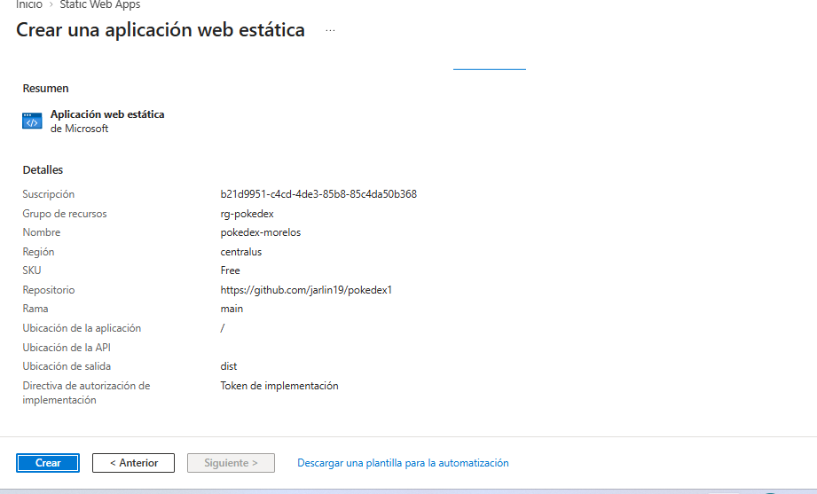

# PokeDex - Despliegue en Microsoft Azure (Azure for Students)

Caso de estudio: Pueblo Paleta Inc. nos contrató para publicar en una nube pública la aplicación PokeDex, desarrollada por PumasLab, cumpliendo requisitos de seguridad web.

- Aplicación desplegada: https://orange-water-0e1117310.2.azurestaticapps.net
- Nube pública: Microsoft Azure, suscripción Azure for Students, servicio Azure Static Web Apps (plan Free)
- Escaneo de seguridad: https://securityheaders.com, calificación A+
- Cómo se desplegó la aplicación: [Despliegue.md](./Despliegue.md)
- Código fuente original: [PokeDex Angular](https://github.com/rcuello/ac4dem1a/tree/master/sistemas-distribuidos/poke-dex-lab) (Angular 14 + PokéAPI). El código de la aplicación no fue modificado; su README original se conserva en [README-pokedex-angular.md](./README-pokedex-angular.md).

Este documento explica paso a paso cómo se creó la cuenta en la nube pública (Microsoft Azure con la oferta Azure for Students), las configuraciones iniciales en el portal y la creación del recurso donde quedó publicada la aplicación.

## Contenido

1. [Por qué Azure for Students](#1-por-qué-azure-for-students)
2. [Requisitos](#2-requisitos)
3. [Creación de la cuenta](#3-creación-de-la-cuenta)
4. [Primeros pasos en el portal](#4-primeros-pasos-en-el-portal)
5. [Creación del recurso Static Web App](#5-creación-del-recurso-static-web-app)
6. [Qué configura Azure al crear el recurso](#6-qué-configura-azure-al-crear-el-recurso)
7. [Límites del plan y recomendaciones](#7-límites-del-plan-y-recomendaciones)
8. [Problemas frecuentes](#8-problemas-frecuentes)
9. [Referencias](#9-referencias)

## 1. Por qué Azure for Students

| Criterio | Azure for Students |
|---|---|
| Costo | Gratis. 100 USD de crédito durante 12 meses más servicios gratuitos. |
| Tarjeta de crédito | No se requiere. Solo verificación académica con el correo institucional. |
| Renovación | Anual, mientras se mantenga la condición de estudiante. |
| Servicio usado en este proyecto | Azure Static Web Apps, plan Free: 0 USD al mes, HTTPS incluido, dominio `*.azurestaticapps.net` y despliegue automático desde GitHub. |

El plan Free de Static Web Apps no consume el crédito de 100 USD, así que el despliegue de PokeDex tiene costo cero.

## 2. Requisitos

- Correo institucional activo (en este caso el de la Fundación Universitaria Tecnológico Comfenalco), con acceso a la bandeja de entrada para recibir el código de verificación.
- Un número de celular para la verificación por SMS.
- Una cuenta de GitHub, porque Static Web Apps publica la aplicación directamente desde un repositorio.
- Navegador web actualizado.

## 3. Creación de la cuenta

1. Entrar a https://azure.microsoft.com/es-es/free/students/ y hacer clic en "Empezar gratis".
2. Iniciar sesión con el correo institucional. Como la universidad usa Microsoft 365, el correo institucional ya es una cuenta profesional o educativa de Microsoft y entra directamente; si no lo fuera, se crea una cuenta Microsoft con ese correo con la opción "Crear una".
3. Verificación académica: Microsoft pide confirmar la condición de estudiante. Se indica el país (Colombia) y el correo institucional, y se pulsa "Comprobar el estado académico". Llega un correo con un enlace de verificación que hay que abrir.
4. Completar el perfil: nombre y apellidos, correo de contacto y teléfono (se recibe un código por SMS). Se aceptan el contrato de suscripción, la declaración de privacidad y los términos de la oferta Azure for Students. En ningún momento se pide tarjeta de crédito.
5. Al pulsar "Registrarse" la suscripción queda activa y el navegador redirige al portal de Azure (Education Hub), donde se muestra el crédito disponible de 100 USD y su fecha de vencimiento.

Para comprobar que la suscripción quedó activa: en https://portal.azure.com se busca "Suscripciones" y debe aparecer "Azure for Students" con estado Activo. Esa misma suscripción es la que se selecciona después al crear cualquier recurso.

## 4. Primeros pasos en el portal

Antes de crear recursos se hicieron estas configuraciones:

| Configuración | Dónde | Valor |
|---|---|---|
| Idioma del portal | Icono de engranaje (Configuración del portal) > Idioma y región | Español |
| Directorio | Configuración del portal > Directorios + suscripciones | Directorio de la universidad (FUNDACION UNIVERSITARIA TECNOLOGICO COMFENALCO) |
| Grupo de recursos | Se crea en el mismo asistente de la Static Web App con "Crear nuevo" | `rg-pokedex` |

Un grupo de recursos es la carpeta lógica que agrupa los recursos de un proyecto. Permite administrarlos juntos y, al terminar el curso, borrar todo de una sola vez.

## 5. Creación del recurso Static Web App

Static Web Apps es el servicio de Azure para aplicaciones web estáticas (HTML, CSS y JavaScript), que es exactamente lo que produce la compilación de un proyecto Angular. El servicio se conecta con el repositorio de GitHub, crea un flujo de GitHub Actions y, en cada cambio de la rama principal, compila y publica la aplicación. Incluye HTTPS, un dominio propio y distribución global del contenido.

Antes de crear el recurso ya existía el repositorio en GitHub con el código fuente de la aplicación (ver [Despliegue.md](./Despliegue.md), sección 3).

En el portal: buscar "Static Web Apps" > Crear (también desde Crear un recurso > Aplicación web estática).

### 5.1 Datos básicos

| Campo | Valor |
|---|---|
| Suscripción | Azure for Students |
| Grupo de recursos | Crear nuevo: `rg-pokedex` |
| Nombre | `pokedex-morelos` |
| Tipo de plan | Free (para proyectos de aficionados o personales) |
| Región | Central US |
| Origen de implementación | GitHub |

Al elegir GitHub como origen, el portal pide iniciar sesión en GitHub y autorizar a Azure Static Web Apps a leer los repositorios de la cuenta (se abre una ventana de GitHub con el botón de autorizar). Después se seleccionan:

| Campo | Valor |
|---|---|
| Organización | `jarlin19` |
| Repositorio | `pokedex` (en el momento de crear el recurso el repositorio se llamaba `pokedex1`; luego se renombró a `pokedex` en GitHub, que redirige el nombre anterior, y la Static Web App siguió desplegando sin ningún cambio) |
| Rama | `main` |
| Valores preestablecidos de compilación | Angular |
| Ubicación de la aplicación | `/` |
| Ubicación de la API | vacío (la aplicación no tiene API propia; consume PokéAPI) |
| Ubicación de salida | `dist` |
| Directiva de autorización de implementación | Token de implementación |

En la pestaña Avanzado y en Etiquetas se dejaron los valores por defecto.

### 5.2 Revisar y crear

El resumen muestra la suscripción, el grupo de recursos `rg-pokedex`, el nombre `pokedex-morelos`, la región `centralus`, el SKU `Free`, el repositorio y la rama `main`. Se pulsa Crear.

### 5.3 Recurso creado

Al terminar la implementación, en Ir al recurso aparece la información general de la Static Web App: el grupo de recursos, la suscripción, el plan Free, el repositorio y la rama vinculados, y la URL asignada por Azure: `https://orange-water-0e1117310.2.azurestaticapps.net`. El nombre del dominio lo genera Azure automáticamente; si se quiere otro nombre se agrega un dominio propio en Dominios personalizados.

El primer despliegue tarda unos minutos, porque Azure crea el flujo de GitHub Actions y lo ejecuta por primera vez. El estado se puede seguir en el repositorio, en la pestaña Actions.

## 6. Qué configura Azure al crear el recurso

Al crear la Static Web App con GitHub como origen, Azure hace dos cosas en el repositorio:

| Elemento | Dónde queda | Para qué sirve |
|---|---|---|
| Flujo de trabajo `azure-static-web-apps-orange-water-0e1117310.yml` | Carpeta `.github/workflows/` del repositorio (Azure hace un commit con él) | Define los pasos que GitHub Actions ejecuta en cada push a `main`: descargar el código, compilarlo y publicarlo en la Static Web App. |
| Secreto `AZURE_STATIC_WEB_APPS_API_TOKEN_ORANGE_WATER_0E1117310` | Settings > Secrets and variables > Actions del repositorio | Token de implementación que autoriza al flujo a publicar en este recurso de Azure. No se escribe en el código. |

El flujo generado por defecto compila con las herramientas de Azure (Oryx). Para este proyecto se ajustó para compilar con los scripts propios del proyecto y publicar la carpeta `dist/pokedex-angular`; el detalle está en [Despliegue.md](./Despliegue.md), sección 5.

En el portal, el recurso tiene estas secciones que conviene conocer:

| Sección | Uso |
|---|---|
| Información general | URL de la aplicación, repositorio y rama vinculados, estado del último despliegue. |
| Configuración > Configuración | Variables de entorno (no se necesitaron). |
| Configuración > Dominios personalizados | Agregar un dominio propio (opcional). |
| Entornos | Entorno de producción y entornos de vista previa de las pull requests. |
| Administrar token de implementación | Permite ver o regenerar el token usado por GitHub Actions. |

## 7. Límites del plan y recomendaciones

- Crédito: 100 USD por 12 meses. El plan Free de Static Web Apps es gratuito y no lo consume.
- Plan Free: 100 GB de ancho de banda al mes por suscripción, 250 MB de contenido por entorno (500 MB en total), hasta 10 aplicaciones por suscripción, 2 dominios personalizados y 3 entornos de vista previa. La compilación de PokeDex ocupa cerca de 4 MB.
- El dominio `*.azurestaticapps.net` incluye certificado HTTPS; no hay que configurar nada.
- Una sola cuenta de Azure for Students por persona; se renueva cada año mientras se siga siendo estudiante.
- Conviene activar la autenticación multifactor en la cuenta Microsoft y en la cuenta de GitHub, y no compartir el token de implementación.
- Al terminar el curso se puede eliminar el grupo de recursos `rg-pokedex` para borrar todo.

## 8. Problemas frecuentes

| Problema | Causa o solución |
|---|---|
| No se puede verificar el estado académico | Usar exactamente el correo institucional, no uno personal. Si persiste, el área de TI de la institución debe confirmar que el dominio esté registrado en Microsoft. |
| No llega el correo de verificación | Revisar la carpeta de correo no deseado y solicitar el reenvío desde la misma página. |
| El portal pide tarjeta de crédito | Se está usando la oferta equivocada (cuenta gratuita de Azure en lugar de Azure for Students). Volver a https://azure.microsoft.com/es-es/free/students/. |
| En el asistente no aparece el repositorio de GitHub | Azure no tiene permiso sobre ese repositorio. Repetir la autorización con la cuenta correcta de GitHub o, en GitHub, Settings > Applications > Azure Static Web Apps > dar acceso al repositorio. |
| El primer despliegue falla con "Failed to find a default file in the app artifacts folder" | El flujo generado por defecto busca `index.html` en la carpeta de salida indicada y no lo encuentra, porque Angular genera la aplicación en una subcarpeta (`dist/pokedex-angular`). La solución está en Despliegue.md, sección 5. |
| El flujo falla con "deployment_token was not provided" | El nombre del secreto en el archivo `.yml` no coincide con el secreto creado por Azure en el repositorio. Copiar el nombre exacto desde Settings > Secrets and variables > Actions. |

## 9. Referencias

- Azure for Students: https://azure.microsoft.com/es-es/free/students/
- Preguntas frecuentes de Azure for Students: https://azure.microsoft.com/es-es/free/students/#faq
- Portal de Azure: https://portal.azure.com
- Azure Static Web Apps: https://learn.microsoft.com/azure/static-web-apps/
- Cuotas de Azure Static Web Apps: https://learn.microsoft.com/azure/static-web-apps/quotas
- Caso de estudio y código fuente: https://github.com/rcuello/ac4dem1a/tree/master/sistemas-distribuidos/poke-dex-lab

Documento elaborado en StackEdit.
